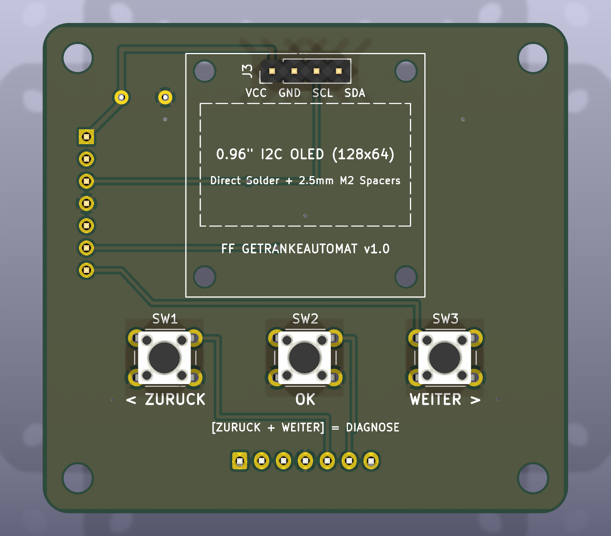
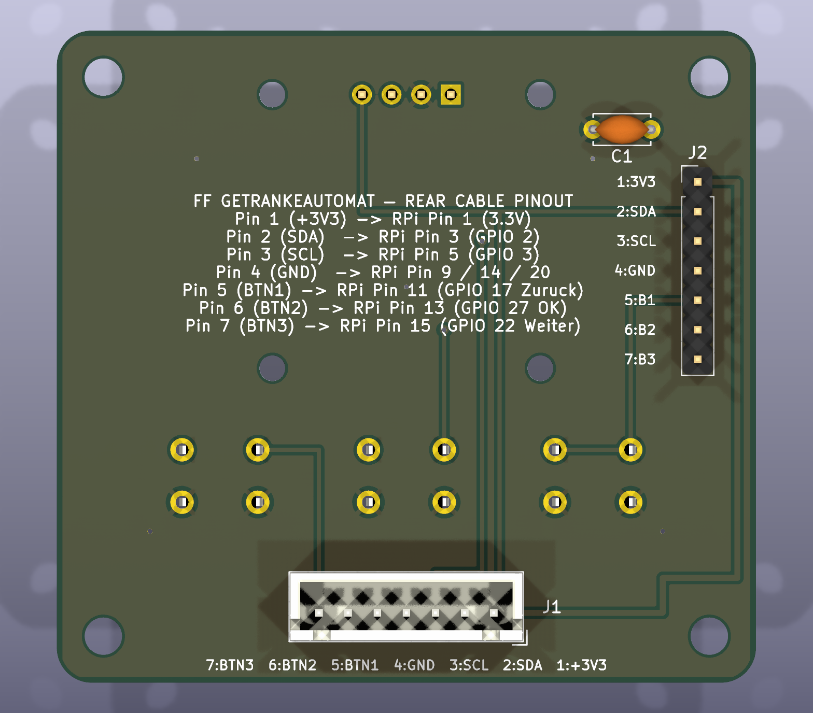

# FF Getränkeautomat – MDB- & FFWEB-Steuerung für den SandenVendo G-Drink DM9

Open-Source-Steuerung auf Basis eines Raspberry Pi, die einen **SandenVendo G-Drink DM9** (über den **MDB-Cashless-Bus**), einen **13,56-MHz-USB-RFID-Leser**, ein **0,96"-I2C-OLED-Display**, **3 Bedientasten** und **FFWEB (`https://www.ffweb.at`)** zur Getränkeverrechnung im Feuerwehrhaus miteinander verbindet.

Läuft zuverlässig selbst auf einem einkernigen **Raspberry Pi 1 Model B+ (ARMv6, 512 MB RAM)** sowie auf neueren Modellen (Pi Zero 2 W, Pi 3, Pi 4, Pi 5).

---

## ✨ Funktionen

- **Zwei Bedienabläufe – „Chip zuerst“ und „Getränk zuerst“:**
  - *Chip zuerst:* Feuerwehr-Chip vorhalten → zwischen privatem Guthaben oder einer offenen Verrechnungsliste wählen → Kredit wird am G-Drink DM9 freigegeben → Getränk am Automaten wählen.
  - *Getränk zuerst:* Fach am G-Drink DM9 wählen → das OLED zeigt `Chip vorhalten` mit Getränkename und Preis → Chip vorhalten, die Ausgabe erfolgt sofort.
- **Verrechnungslisten / Anlässe:**
  - Offene Listen für Einsätze, Übungen oder Kameradschaftsabende / Sitzungen direkt im Web-Dashboard anlegen.
  - Sind Listen offen, wählen Mitglieder mit den **3 Tasten** (`Zurück`, `OK`, `Weiter`) zwischen **Privat (Guthaben)** und einer aktiven **Verrechnungsliste** (`0,00 EUR` privat, Buchung auf den Anlass).
- **Sichere Abrechnung – kein Abzug bei Störung oder Abbruch:**
  - Durchgehend Ganzzahl-Arithmetik in Cent.
  - Abgebucht wird **erst**, wenn der optische Ausgabesensor des DM9 `c,VEND,SUCCESS` meldet. Steckengebliebene Flaschen (`c,ERR,VEND 3`) oder abgebrochene Auswahlen (`c,ERR,VEND 1`) kosten `0,00 EUR`.
- **Offline-fähige SQLite-Warteschlange & idempotente FFWEB-Synchronisation:**
  - Jeder Verkauf wird sofort lokal in SQLite (`WAL`-Modus) mit eindeutigem `idempotency_key` (UUID) gespeichert.
  - Ist das WLAN/LAN oder FFWEB vorübergehend nicht erreichbar, überträgt ein Hintergrunddienst offene Buchungen automatisch nach – ohne Doppelbuchungen.
- **0,96"-OLED-Statusanzeige & Hardware-Überwachung:**
  - 4-zeilige Anzeige (`SSD1306` / `SH1106`, `128×64`) mit Bildschirmschoner, Boot-Splash und automatischer Textanpassung.
  - **OLED-Hot-Plug:** Wird das Display kurz getrennt oder verliert es die Versorgung, verbindet es sich automatisch neu und wird ohne Flackern neu initialisiert.
  - **RFID-Überwachung:** Wird der USB-Leser abgesteckt, erscheint sofort `FEHLER: RFID / Lesegerät getrennt / USB prüfen!`; nach dem Wiederanstecken läuft alles innerhalb von ca. 1,5 s weiter.
  - **Diagnose-Kombination (Taste 1 + 3):** Gleichzeitiges Drücken der linken und rechten Taste zeigt 10 Sekunden lang LAN-IP, MDB-Status, RFID-Status und die Anzahl offener Synchronisationen.
- **Web-Dashboard & virtueller G-Drink-DM9-Simulator (`/`):**
  - Fachbelegung, Test-Chips und Verrechnungslisten verwalten sowie den Live-Zustand der Hardware per Server-Sent Events (SSE) verfolgen.
  - Vollständiger Browser-Simulator für DM9, RFID-Leser, 3 Tasten und einen 128×64-OLED-Spiegel – alles lässt sich testen, bevor echte MDB-Hardware angeschlossen ist.

---

## 🛒 Stückliste

| Komponente | Empfohlenes Modell / Spezifikation | Schnittstelle | Hinweise |
| :--- | :--- | :--- | :--- |
| **Einplatinenrechner** | Raspberry Pi 1 Model B+ Rev 1.2 (oder Pi 3B+ / 4B / Zero 2 W) | Ethernet / USB / 40-Pin-GPIO | Debian Trixie / Raspberry Pi OS (32 oder 64 Bit) |
| **Kühlung (empfohlen beim Pi 1)** | 5-V-Alu-Kühlkörper + Lüfter + Kupfer-Shim (`15×15 mm`) | 5 V & GND (GPIO) | Ermöglicht stabilen 1000-MHz-Turbo bei ca. 30 °C |
| **MDB-Cashless-Interface** | **Qibixx MDB-USB Interface** (oder Qibixx MDB Pi HAT) | USB-CDC seriell (`/dev/ttyACM0`) | Verbindet den Pi mit dem 6-poligen Molex-MDB-Bus des Automaten |
| **RFID-Leser** | **13,56-MHz-USB-HID-Leser** (z. B. `Sycreader` / `IC_Reader 08ff:0009`) | USB-HID (`evdev`) | Liefert eine 10-stellige dezimale UID von MIFARE-Classic-/NFC-Chips |
| **OLED-Display** | **0,96"-I2C-OLED (`128×64`)** (`SSD1306` oder `SH1106`) | I2C (`/dev/i2c-1`, `0x3C`) | 4-polig (`VCC`, `GND`, `SCL`, `SDA`) |
| **Bedientasten (3×)** | Taster (6-mm-Printtaster oder 12/16-mm-Einbautaster) | GPIO + GND (Active-Low) | Nutzt die internen Pull-ups des Pi – keine externen Widerstände nötig |
| **Frontplatine (optional)** | [Eigene Frontplatine](#-frontplatine-oled--3-tasten) mit OLED + 3 Tastern | 7-polig JST-XH / Stiftleiste | Siehe [`hardware/front_panel_pcb`](hardware/front_panel_pcb/) |
| **Netzteil & Speicher** | Offizielles 5-V-Netzteil + 16-GB-Industrie-microSD | Strom / SD | High-Endurance-microSD für Dauerbetrieb empfohlen |
| **Getränkeautomat** | **SandenVendo G-Drink DM9** (mit SF01-Steuerplatine) | MDB-Slave | Lift-Automat für Flaschen/Dosen |

---

## 🔌 Verdrahtung (40-Pin-GPIO-Leiste des Raspberry Pi)

Alle Komponenten werden direkt an die GPIO-Leiste angeschlossen – ein zusätzlicher HAT ist nicht nötig:

```text
                 Raspberry Pi 40-Pin-GPIO-Leiste (Pins 1–20)
                 ┌──────────────────────┬──────────────────────┐
   OLED VCC  <── │ (01) 3,3 V           │ (02) 5 V             │──> Lüfter + (rot)
   OLED SDA  <── │ (03) GPIO 2 (SDA1)   │ (04) 5 V             │
   OLED SCL  <── │ (05) GPIO 3 (SCL1)   │ (06) GND             │──> Lüfter – (schwarz)
                 │ (07) GPIO 4          │ (08) GPIO 14 (TXD)   │
   OLED GND  <── │ (09) GND             │ (10) GPIO 15 (RXD)   │
   Taste 1   <── │ (11) GPIO 17         │ (12) GPIO 18         │
   Taste 2   <── │ (13) GPIO 27         │ (14) GND             │──> GND Taste 1 & 2
   Taste 3   <── │ (15) GPIO 22         │ (16) GPIO 23         │
                 │ (17) 3,3 V           │ (18) GPIO 24         │
                 │ (19) GPIO 10 (MOSI)  │ (20) GND             │──> GND Taste 3
                 └──────────────────────┴──────────────────────┘
```

### 1. 0,96"-I2C-OLED (`SSD1306` @ `0x3C`)
| OLED-Pin | Physischer Pin am Pi | GPIO / Funktion |
| :--- | :--- | :--- |
| **VCC** | **Pin 1** | `3,3 V` |
| **GND** | **Pin 9** | `GND` |
| **SDA** | **Pin 3** | `GPIO 2 (I2C1 SDA)` |
| **SCL** | **Pin 5** | `GPIO 3 (I2C1 SCL)` |

### 2. Drei Bedientasten (Active-Low mit internem Pull-up)
Jeder Taster hat zwei Anschlüsse: einer an den **GPIO-Pin**, der andere an einen beliebigen **GND-Pin** (Pins `14` und `20` liegen direkt gegenüber; alternativ eine gemeinsame Masseleitung durchschleifen).

| Position | Funktion | GPIO (BCM) | Physischer Pin | GND-Pin |
| :--- | :--- | :--- | :--- | :--- |
| **Taste 1 (links)** | **Zurück / Abbruch** | `GPIO 17` | **Pin 11** | **Pin 14** |
| **Taste 2 (Mitte)** | **Auswahl / OK** | `GPIO 27` | **Pin 13** | **Pin 14** |
| **Taste 3 (rechts)** | **Weiter ▶** | `GPIO 22` | **Pin 15** | **Pin 20** |

> **Tipp:** Im Ruhezustand (`IDLE`) **Taste 1 + Taste 3** gleichzeitig drücken, um das **10-Sekunden-Diagnosemenü** auf dem OLED anzuzeigen.

### 3. 5-V-Lüfter
| Lüfterkabel | Physischer Pin am Pi | Funktion |
| :--- | :--- | :--- |
| **Rot (+5 V)** | **Pin 2** oder **Pin 4** | `5 V` |
| **Schwarz (GND)** | **Pin 6** | `GND` |

### 4. USB-Geräte
- **USB-Port 1:** 13,56-MHz-USB-HID-RFID-Leser (`/dev/input/by-id/usb-...-event-kbd`).
- **USB-Port 2:** Qibixx MDB-USB Interface (`/dev/ttyACM0`), über den MDB-Kabelbaum mit dem G-Drink DM9 verbunden.

---

## 🟩 Frontplatine (OLED + 3 Tasten)

<p align="center">
  
  
</p>

Für einen sauberen Einbau in die Automatentür gibt es eine eigene 2-lagige Frontplatine (`60 × 56 mm`, KiCad 9):

- **Vorderseite:** nur das 0,96"-OLED und die 3 Taster (`Zurück`, `OK`, `Weiter`) – keine sichtbaren Kabel.
- **Rückseite:** 7-poliger JST-XH-Stecker (`J1`) bzw. alternativ 7-polige 2,54-mm-Stiftleiste (`J2`) sowie der 100-nF-Abblockkondensator.
- Die 7 Signale (`+3V3`, `SDA`, `SCL`, `GND`, 3× Taster) passen direkt auf die Pins 1–15 der linken Reihe der GPIO-Leiste – exakt nach der Belegung oben.
- Fertige Gerber-Daten, BOM, Bestückungsdaten (JLCPCB) und ein STEP-Modell liegen in [`hardware/front_panel_pcb/production/`](hardware/front_panel_pcb/production/).

Details zu Pinbelegung, Abmessungen und Stückliste: [`hardware/front_panel_pcb/README.md`](hardware/front_panel_pcb/README.md).

---

## ⚙️ Hinweis zum RFID-UID-Format (USB-Leser vs. Smartphone-App)

Normale 13,56-MHz-MIFARE-Classic-Chips haben eine 4 Byte lange Seriennummer.
- **Smartphone-Apps (z. B. NFC Tools):** zeigen die Bytes in MSB-Reihenfolge (`04:A2:F3:9B`).
- **USB-Leser (10-stellige Dezimalausgabe):** drehen die 4 Bytes um (LSB zuerst: `9B F3 A2 04`) und geben den 32-Bit-Wert als 10-stellige Dezimalzahl mit führenden Nullen aus (`2616435204`).
- Mit dem **Live-Chip-Scanner** im Web-Dashboard (`http://<pi-ip>:8000`) sieht man die exakte UID des USB-Lesers und kann sie mit einem Klick kopieren.

---

## 🚀 Schnellstart (lokale Entwicklung & Simulator unter macOS / Linux)

Das komplette System läuft auch ohne angeschlossene Hardware mit dem eingebauten Simulator:

```bash
git clone https://github.com/pet210702/ffweb-pi-mdb-vending.git
cd ffweb-pi-mdb-vending

python3 -m venv .venv
source .venv/bin/activate
pip install -r requirements.txt

# Automatische Tests ausführen
pytest -v

# FastAPI-Server + virtuellen G-Drink DM9 starten
uvicorn app.main:app --reload --port 8000
```

- **Web-Dashboard & Simulator:** `http://localhost:8000`
- **Interaktive API-Dokumentation (OpenAPI):** `http://localhost:8000/docs`

---

## 🍓 Installation auf dem Raspberry Pi

### Schritt 1: Projekt kopieren & Installer ausführen
Das Repository vom Arbeitsrechner auf den Pi kopieren und [`deploy/install_pi.sh`](deploy/install_pi.sh) starten:

```bash
scp -r . ffadmin@<pi-ip>:~/getraenkeautomat
ssh ffadmin@<pi-ip> "bash ~/getraenkeautomat/deploy/install_pi.sh"
```

Was [`deploy/install_pi.sh`](deploy/install_pi.sh) automatisch erledigt:
1. Installiert vorkompilierte Debian-/Raspberry-Pi-OS-Pakete (`python3-fastapi`, `python3-uvicorn`, `python3-httpx`, `python3-serial`, `python3-evdev`, `python3-luma.oled`, `python3-gpiod`, `i2c-tools`, `fonts-dejavu-core`) – dadurch ist die Installation auch auf 32-Bit-ARMv6 in Sekunden erledigt.
2. Aktiviert den I2C-Bus (`/dev/i2c-1`) und fügt den Benutzer den Gruppen `input`, `dialout`, `i2c` und `gpio` hinzu.
3. Installiert die Anwendung nach `/opt/getraenkeautomat` und legt `/opt/getraenkeautomat/.env` aus `.env.example` an.
4. Richtet zwei `systemd`-Dienste ein und aktiviert sie:
   - `getraenkeautomat-boot-oled.service`: zeigt sofort einen Boot-Splash am OLED, sobald `/dev/i2c-1` verfügbar ist.
   - `getraenkeautomat.service`: startet die FastAPI-/Uvicorn-Steuerung mit automatischem Neustart.

### Schritt 2 (optional): Schnellstart & Übertaktung für den Raspberry Pi 1
Auf einem **Raspberry Pi 1 Model B+** mit aktiver Kühlung deaktiviert [`deploy/optimize_pi.sh`](deploy/optimize_pi.sh) nicht benötigte Dienste (`cloud-init`, `bluetooth`, `wpa_supplicant`, `NetworkManager-wait-online`) und aktiviert das offizielle 1000-MHz-Turbo-Profil:

```bash
ssh ffadmin@<pi-ip> "bash /opt/getraenkeautomat/deploy/optimize_pi.sh && sudo reboot"
```

---

## 🔄 Vom Simulator auf echte MDB-Hardware & FFWEB umstellen

`/opt/getraenkeautomat/.env` auf dem Pi bearbeiten und den Dienst neu starten (`sudo systemctl restart getraenkeautomat`):

### 1. Qibixx MDB-USB Interface aktivieren
```ini
MDB_MODE=qibixx
MDB_SERIAL_PORT=/dev/ttyACM0
MDB_BAUDRATE=115200
```
*Auf der SF01-Steuerplatine des G-Drink DM9 muss das Protokoll auf **MDB** eingestellt und die bargeldlose Zahlung unter `PAYMENT SETTING` aktiviert sein.*

### 2. Live-Anbindung an FFWEB aktivieren
```ini
FFWEB_MODE=http
FFWEB_BASE_URL=https://api.ffweb.at
FFWEB_API_KEY=dein_api_token_der_wache
FFWEB_MEMBER_LOOKUP_PATH=/api/v1/vending/members/{chip_uid}
FFWEB_PRODUCTS_PATH=/api/v1/vending/products
FFWEB_VEND_PATH=/api/v1/vending/consumptions
```

### 3. Übersicht aller `.env`-Einstellungen

| Variable | Standard | Beschreibung |
| :--- | :--- | :--- |
| `HOST` / `PORT` | `0.0.0.0` / `8000` | Adresse und Port des HTTP-Servers |
| `DB_PATH` | `data/vending.db` | Pfad der lokalen SQLite-Datenbank (WAL-Modus) |
| `ADMIN_API_TOKEN` | *(leer)* | Optionaler `X-Admin-Token` / Bearer-Token für schreibende Admin-Routen |
| `MDB_MODE` | `simulator` | `simulator` (virtueller DM9) oder `qibixx` (echte serielle MDB-Hardware) |
| `MDB_SERIAL_PORT` | `/dev/ttyACM0` | Serielles Gerät des Qibixx MDB-USB / Pi HAT |
| `MDB_BAUDRATE` | `115200` | Baudrate der seriellen MDB-Schnittstelle |
| `RFID_MODE` | `auto` | `auto` (Linux-`evdev`, falls vorhanden), `evdev` oder `simulator` |
| `RFID_DEVICE_PATH` | *(leer)* | Optional expliziter Pfad `/dev/input/by-id/...` (sonst automatische Erkennung) |
| `OLED_MODE` | `auto` | `auto` (`ssd1306` an `/dev/i2c-1`), `ssd1306`, `sh1106` oder `disabled` |
| `OLED_I2C_PORT` | `1` | I2C-Bus-Nummer |
| `OLED_I2C_ADDRESS` | `0x3C` | I2C-Adresse des OLED-Displays |
| `OLED_SCREENSAVER_SEC` | `90` | Sekunden ohne Aktivität bis zum Abschalten des OLED |
| `OLED_STARTUP_DIAG_SEC` | `6` | Anzeigedauer der Diagnose nach dem Start |
| `BUTTONS_MODE` | `auto` | `auto` (`/dev/gpiochip0` über `libgpiod` v2), `simulator` oder `disabled` |
| `BUTTONS_CHIP_PATH` | `/dev/gpiochip0` | GPIO-Chip für die Tasten |
| `BUTTON_PIN_BACK` | `17` | BCM-GPIO für Taste 1 (links: Zurück / Abbruch) |
| `BUTTON_PIN_SELECT` | `27` | BCM-GPIO für Taste 2 (Mitte: Auswahl / OK) |
| `BUTTON_PIN_NEXT` | `22` | BCM-GPIO für Taste 3 (rechts: Weiter) |
| `BUTTON_DEBOUNCE_MS` | `50` | Entprellzeit der Tasten in Millisekunden |
| `BILLING_SELECTION_TIMEOUT_SEC` | `12` | Sekunden, bis die Auswahl Privat/Verrechnungsliste abläuft |
| `SESSION_TIMEOUT_SEC` | `30` | Sekunden, die ein freigegebener MDB-Kredit am DM9 offen bleibt |
| `AWAITING_CHIP_TIMEOUT_SEC` | `15` | Sekunden, die bei „Getränk zuerst“ auf einen Chip gewartet wird |
| `DISPENSE_TIMEOUT_SEC` | `25` | Maximale Wartezeit auf die Bestätigung des Ausgabesensors |
| `ALLOW_UNMAPPED_SLOTS` | `false` | Ob nicht zugeordnete Fächer zum Automatenpreis verkauft werden dürfen |
| `FFWEB_MODE` | `mock` | `mock` (lokale Mitglieder/Guthaben in SQLite) oder `http` (echte FFWEB-REST-API) |
| `FFWEB_TIMEOUT_SEC` | `4.0` | Timeout für FFWEB-Anfragen in Sekunden |
| `SYNC_RETRY_INTERVAL_SEC` | `10` | Intervall für erneute Synchronisationsversuche |

---

## 🗂️ Projektstruktur

```text
.
├── app/
│   ├── api/routes.py          # FastAPI-REST-Endpunkte & SSE-Echtzeitstream
│   ├── buttons/               # GPIO-Treiber für die 3 Tasten (libgpiod v2 + Kombinationserkennung)
│   ├── ffweb/                 # Mock- & HTTP-FFWEB-Client + robuster Synchronisationsdienst
│   ├── mdb/                   # Qibixx-MDB-Cashless-Treiber & virtueller G-Drink-DM9-Simulator
│   ├── oled/                  # SSD1306/SH1106-OLED-Ansteuerung (128×64) & Boot-Splash
│   ├── rfid/                  # evdev-USB-HID-Leser mit Hot-Plug- & Trennungserkennung
│   ├── static/index.html      # Admin-Dashboard & virtueller Hardware-Simulator
│   ├── config.py              # Laden der Konfiguration aus Umgebungsvariablen
│   ├── db.py                  # SQLite-WAL-Speicher (Fächer, Mitglieder, Listen, Verkaufsprotokoll)
│   ├── events.py              # Asynchroner Pub/Sub-Eventbus
│   ├── main.py                # FastAPI-Lebenszyklus & Verdrahtung der Dienste
│   └── state_machine.py       # Zentrale Zustandsmaschine (Chip zuerst, Getränk zuerst, Listen)
├── deploy/
│   ├── getraenkeautomat-boot-oled.service  # systemd-Unit für den OLED-Boot-Splash
│   ├── getraenkeautomat.service            # systemd-Unit der Hauptsteuerung
│   ├── install_pi.sh                       # Installer für den Raspberry Pi
│   └── optimize_pi.sh                      # Schnellstart- & 1000-MHz-Skript für den Pi 1
├── hardware/
│   └── front_panel_pcb/       # KiCad-Projekt der Frontplatine (OLED + 3 Taster) inkl. Fertigungsdaten
├── tests/                     # pytest-Tests (Verkaufsabläufe, Listen, Hardware-Sonderfälle)
├── .env.example               # Beispielkonfiguration
├── pyproject.toml             # Projekt- & pytest-Einstellungen
└── requirements.txt           # Python-Abhängigkeiten
```

---

## 📄 Lizenz

Veröffentlicht unter der [MIT-Lizenz](LICENSE).
